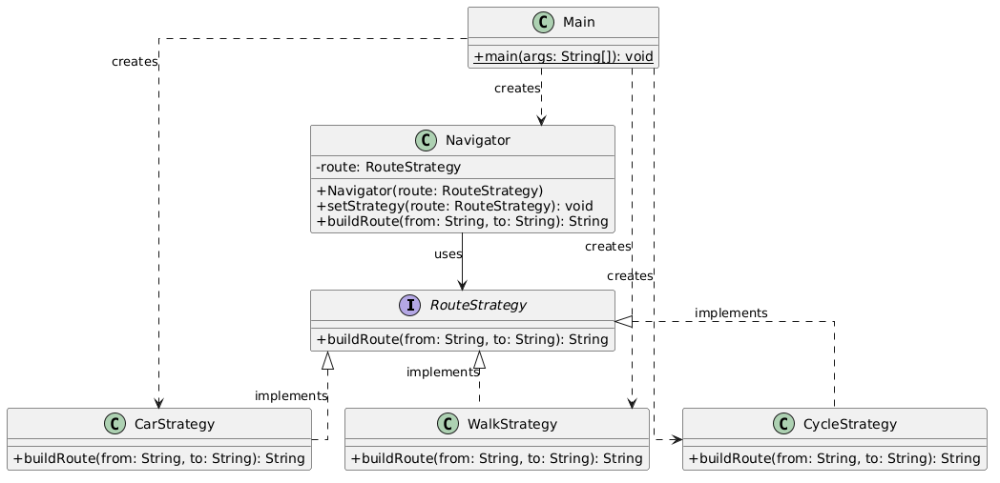

# Assignment 5
## Strategy Design Pattern

**Topic:** Option A. Navigation / Route Planning

## 1. Introduction

This project demonstrates the Strategy Design Pattern using a Navigation System in Java. It includes three route strategies: CarStrategy, WalkStrategy, and CycleStrategy, which implement the common RouteStrategy interface.

The Navigator class uses the selected strategy, while Main allows switching between strategies at runtime without modifying the Navigator class.

## 2. UML Diagram



The UML diagram shows the structure of the Strategy Pattern in the Navigation System.

RouteStrategy is the common interface implemented by CarStrategy, WalkStrategy, and CycleStrategy. Navigator acts as the Context and holds a reference to RouteStrategy through an association relationship. Main acts as the Client and creates the Navigator and strategy objects through dependency relationships.

This structure allows strategies to be switched at runtime without changing the Navigator class.

## 3. Clean Code

### 3.1 Elimination of Conditional Logic

**Before:** Navigator would use multiple if-else statements to choose between car, walking, and cycling routes, making the code more complex.

**After:** Navigator uses `route.buildRoute(from, to)` to delegate the work to the selected strategy without conditional statements.

```java
return route.buildRoute(from, to);
```

### 3.2 Meaningful Names

**Before:** Generic names like Strategy1 or Strategy2 would make it difficult to understand the purpose of each class.

**After:** Meaningful names such as CarStrategy, WalkStrategy, and CycleStrategy clearly describe their responsibilities.

```java
public class CarStrategy implements RouteStrategy {
}
```

### 3.3 Single Responsibility Principle (SRP)

**Before:** Navigator would contain the logic for all route types, giving it multiple responsibilities.

**After:** Each strategy class handles only one type of route. For example, CarStrategy is responsible only for car routes.

```java
public class CarStrategy implements RouteStrategy {
    @Override
    public String buildRoute(String from, String to) {
        return "Car route: " + from + " -> Highway -> " + to;
    }
}
```

### 3.4 Open/Closed Principle (OCP)

**Before:** Adding a new route type would require modifying Navigator and adding more conditional statements.

**After:** A new strategy can be created by implementing RouteStrategy without changing the Navigator class.

```java
public class CycleStrategy implements RouteStrategy {
    @Override
    public String buildRoute(String from, String to) {
        return "Cycling route: " + from + " -> Cycle lane -> " + to;
    }
}
```

### 3.5 Dependency on Abstraction

**Before:** Navigator would depend directly on a specific class, such as CarStrategy, making it difficult to switch algorithms.

**After:** Navigator depends on the RouteStrategy interface, allowing it to work with any strategy implementation.

```java
private RouteStrategy route;
```

## 4. Strategy vs. State

Strategy Pattern is used because the Navigation System provides different algorithms for the same task: building a route. The Client selects and switches between CarStrategy, WalkStrategy, and CycleStrategy at runtime.

Unlike Strategy, State Pattern changes an object's behavior based on its current state or lifecycle stage. Our system doesn't have such states or transitions, so Strategy is the appropriate choice.

## 5. Conclusion

This project demonstrates how the Strategy Pattern makes a Navigation System more flexible and easier to maintain. New route strategies can be added without modifying the Navigator class.

Although this pattern requires more classes, it improves code organization, reusability, and extensibility.

## 6. GitHub Repository

https://github.com/aiymissabayeva/NavigationSystem.git
